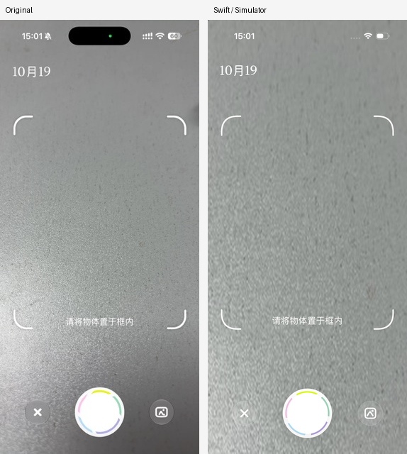

# 相机界面对齐与 IPA 检查

按用户提供的 281 × 612 相机截图对齐白色日期、四角取景框、中文提示、彩色快门和两侧半透明按钮。模拟器截图来自实际 SwiftUI 渲染；预览背景使用参考图中不含控件的桌面纹理，所有文字和控件独立绘制。真机继续使用 AVFoundation 实时预览。

## 对照图



- [原版截图](reference.jpeg)
- [模拟器相机布局](camera-reference.png)
- [模拟器正常示例取景](camera-demo.png)

相机快门约 100pt，辅助按钮 50pt；在本次 402 × 874pt 模拟器上，取景框约 346 × 428pt，左右边距约 28pt。取景提示为 18pt 白字。取景框和快门位置按用户截图确定，并非直接套用 2.0.9 包中的旧版尺寸。

状态栏使用系统深色外观提供白色文字，退出相机后恢复浅色外观。动态岛、绿色相机指示灯和实际摄像头画面由设备与系统提供，模拟器截图没有完整复现这些元素。只在 DEBUG 模拟器中使用 `--camera-layout-reference` 背景；正常示例带有可拍摄的甜甜圈主体。

## `cap.ipa` 是否加密

| 包 | 版本／构建 | `LC_ENCRYPTION_INFO_64.cryptid` | 结论 |
| --- | --- | --- | --- |
| `cap.ipa` | 2.0.9 / 445 | 0 | 主程序未加密，可做静态反汇编与反编译 |
| `CapWords_2.0.11.ipa` | 2.0.11 / 23 | 1 | 主程序仍有加密代码区域，不能据此恢复完整函数实现 |

`cryptsize` 非零不等于仍加密，应结合 `cryptid` 判断。这里的结论针对主程序，不表示已逐一检查所有嵌套框架。

## REA 能看到什么

REA 已实际打开 `cap.ipa` 和其 ARM64 主程序，读取 Mach-O 结构与加密命令。当前 REA 的函数反编译调用返回 `provider_unavailable`：Ghidra 未配置，Hopper 不在配置位置，IDA MCP 未配置。因此本次没有得到 REA 函数伪代码；下列实现线索来自同一主程序的既有 LLVM 指令、ObjC／Swift 元数据和本地化资源，并经样本哈希核对。

| 位置 | 观察到的实现线索 |
| --- | --- |
| `CameraViewController` | `captureSession`、`photoOutput`、`movieOutput`、`previewLayer`，以及照片／录像回调 |
| `StickerCameraViewController` | 相机、取景框、裁剪控制器与识别处理的组合 |
| `StickerCameraBoundsContentView` | SwiftUI 取景框，由对应 ViewModel 控制显示、透明度、焦点、缩放和底部遮挡 |
| `CameraBarContentView` / `CameraBarState` | 相册选择、快门交互及 normal、capture、loading、completion 等状态 |
| `0x10045eefc` | 预览配置为 `AVLayerVideoGravityResizeAspectFill` |
| `0x100462b24` | 调用 `capturePhotoWithOutput:settings:delegate:` |
| `0x1004641cc` | 拍照结果读取 `fileDataRepresentation` |
| `0x1004691a0` | 照片框宽度为可用边长的 0.8，高宽比为 420 / 340；仅代表该版本分支 |
| `0x1004698a4` | 框资源名为 `camera.bounds.new`，以 SwiftUI Image 拉伸显示 |

这可以确认实现结构并指导重建，但不是原始 Swift 源码，也不能证明截图所用版本与 2.0.9 一致。原版 IPA 本轮没有运行，录像、Live Photo、双击切换镜头等行为也没有在重建应用中宣称完成。

## 证据与复核路径

证据目录：[`camera-alignment`](../../../capwords-analysis/evidence/ipa/camera-alignment/)。

| Evidence | Finding | Path |
| --- | --- | --- |
| `static-camera-review.json`；两份 IPA 的 SHA-256、plist、独立解析与 `otool` 结果 | 2.0.9 `cryptid=0`；2.0.11 `cryptid=1` | `python3 capwords-analysis/verify_camera_alignment.py` |
| REA `ev_1e6a4997847a645d01532efee6f5d4106d48518065b5ab54e2821be7cee64f6f` | ARM64 Mach-O，主程序 SHA-256 为 `6954430ff4342d6f2b9a096245caf1921f3e3503212f438904378548e87b0265` | `rea-session-2026-10-19.json` 中的 `inspect_macho` |
| REA `ev_2e985ec80cdaf92c1f9a5068360dfe05958be3c38eda0864c9a3ee22ece758ea` | 加密命令中的 `cryptid=0` | 同一包内的 load_commands 视图 |
| `provider-unavailable.json`、`rea-function-unavailable.json` | REA 函数分析受本机引擎配置限制 | `search_procedures`／`analyze_function` 错误诊断 |
| `E-imports`：`imports-review.json` | 导入包含 AVFoundation 相机类、SwiftUI、Photos、密码学、网络与文件 API；不表示这些 API 本次实际执行 | `/usr/bin/nm -u capwords-analysis/evidence/ipa/camera-alignment/cap-main`；分类仅为候选名称匹配，导入表可能不完整 |
| 原版截图与本地运行截图 | 验证界面位置、颜色、尺寸与图标 | 本目录 `comparison.png` |

范围与时间线见证据目录中的 `scope.md`、`timeline.md`。报告类型为普通应用逆向与 UI 重建，无漏洞或恶意软件结论。

## 重现界面验证

从仓库根目录执行：

```bash
bash CapWordsSwift/scripts/verify.sh build-for-testing
CAPWORDS_SIMULATOR_ID=4607AA88-3821-4245-91AA-A1E6B8E407E4 \
  python3 CapWordsSwift/scripts/capture_camera_alignment.py
```

截图脚本需要 Pillow 和已启动的 iPhone 模拟器，可通过环境变量替换设备 ID。它会安装当前本地构建，启动隔离测试模式，截取页面并在结束时清除临时状态栏覆盖，不修改用户词库。`comparison.png` 将真实截图等比缩小到原图大小并排展示，未覆盖或粘贴原版控件。

构建与 UI 测试的结果保存在本目录 `validation.txt`。
