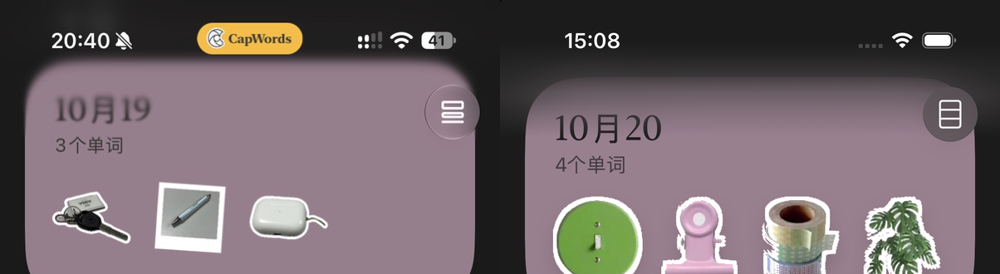

# 首页顶部安全区渐变模糊

按参考图调整首页滚动时的顶部过渡：移除固定 64pt 纯色遮罩，使用 ultraThinMaterial 模糊下方实际滚动内容，再以渐变透明度与主题背景色柔和过渡。遮罩覆盖实际顶部安全区，并向内容区延伸 48pt；浅色和深色使用对应主题背景。

右上角菜单绘制在模糊层上方，保持图标清晰。模糊层不响应触摸，也不参与辅助功能焦点。

构建通过，已检查 iPhone 17 Pro / iOS 26.1 的[深色首页](dark-home.png)、[浅色首页](light-home.png)和[滚动到底](dark-home-bottom.png)。状态栏文字清晰，顶部内容渐变淡出，最后一张日期卡片仍完整位于底栏上方。截图由 Debug 滚动入口采集。

实现见 [HomeView.swift](../../App/Views/HomeView.swift) 中的 HomeScrollTopEdge。
