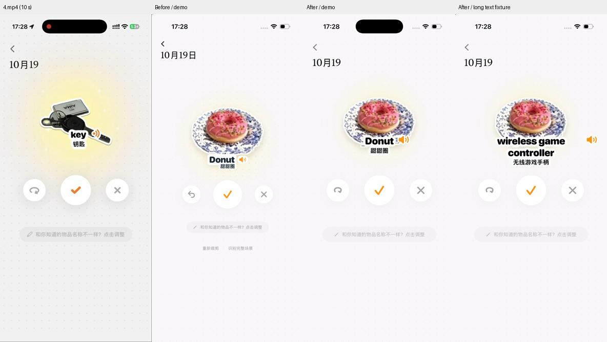
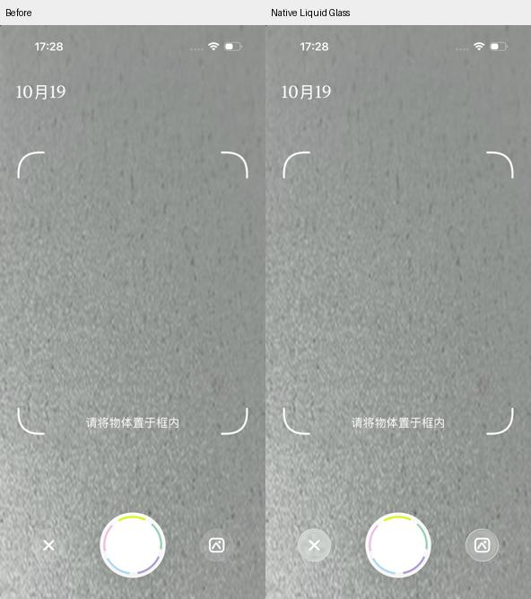

# 识别结果与原生玻璃验收

本轮按 `4.mp4` 的抠图确认和最终结果画面修正布局。中文现在独立占行、完整换行；缺失时显示可点按补充入口。词条和词库标签改用随文字 alpha 生成的白色轮廓，相机关闭和相册按钮在 iOS 26+ 使用原生 `glassEffect(.clear.interactive(), in: Circle())`。结果页按钮位置和直径通过像素测量，5 个结果场景通过中文 OCR 与按钮避让检查。

本地示例原先已有中文，因此没有将用户遇到的“中文缺失”断言为已证实的接口故障。已确认的问题是英文、中文共用负间距且分开套矩形白底，以及按钮尺寸偏小、坐标参照不一致；本次改为独立中文行和整体文字轮廓。没有真实 API 响应可用于验证用户的线上个例，详见[研究报告](../2026-10-19_逆向-CapWords词条与按钮-report.md)。





## 验证结果

- iPhone 17 Pro / iOS 26.1，402 × 874 pt：7 个隔离场景截图，来自真实 SwiftUI 渲染。
- `after/donut.png`：英文和“甜甜圈”各占一行。
- `after/long.png`：两行英文和“无线游戏手柄”完整显示，中文底部位于屏高 46.08%，没有覆盖确认按钮。
- `after/key.png`：检查短词 `key` / “钥匙”的白色字形轮廓和朗读位置。
- `after/missing.png`：空中文显示“补充中文名称”，点击词条或确认保存会进入编辑；不编造译文。
- `after/slow.png`：8 秒延迟返回后中文显示正常。
- `after/camera.png`：原生透明玻璃的折射与高光；iOS 18–25 代码回退系统 material，未单独运行旧系统。
- `after/cutout.png`：100 pt 主确认按钮、50 pt 两侧按钮，中心位于屏高 90.2%。
- `geometry-validation.json`：5 个结果场景的三按钮测量通过；位置 x=22.6%、50%、77.4%，y=53.7%；直径约屏宽 15%、20%、15%。修改前相同断言失败（两侧 x≈26.1%/73.8%，直径≈11.9%）。
- `after/text-validation.json`：系统 Vision OCR 在 5 个场景读到预期中文并验证其底部在操作区上方。
- `core-tests.log`：39 项通过（9 个 XCTest + 30 个 Swift Testing），包含成功响应保留中文、空中文响应被拒绝。
- `build.log`：应用和 UI 测试产物构建成功；没有执行 XCTest 触摸自动化，也没有验证真机摄像头、线上接口或相册交互。

短词和长词 fixture 只替换文字，仍使用同一甜甜圈素材测试布局，不代表把甜甜圈识别成钥匙或手柄。图片未做清晰度增强或粘贴原版控件。裁剪和完整场景操作保留在调整入口的长按菜单中。

## 复现

在仓库根目录执行，需已启动模拟器；`CAPWORDS_SIMULATOR_ID` 可覆盖脚本默认设备。

```bash
bash CapWordsSwift/scripts/verify.sh build-for-testing
python3 CapWordsSwift/scripts/capture_result_alignment.py after
python3 CapWordsSwift/scripts/verify_result_alignment.py CapWordsSwift/docs/result-alignment-validation/after/donut.png
DEVELOPER_DIR=/Volumes/homex/Applications/Xcode-beta.app/Contents/Developer \
  swift -module-cache-path /tmp/capwords-result-ocr-cache \
  CapWordsSwift/scripts/verify_result_text.swift CapWordsSwift/docs/result-alignment-validation/after
```

`capture_result_alignment.py before` 仅用于修改前的构建。当前构建重新执行该参数不能恢复旧界面。
