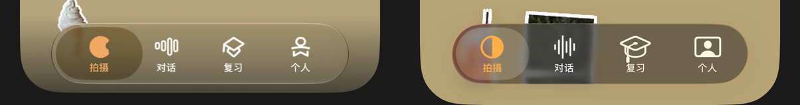

# TabBar 尺寸对齐

2026-10-20，依据用户提供的 602 × 1308 参考图调整底栏。对照图左侧是参考图，右侧是更新后的 iPhone 17 Pro / iOS 26.1 模拟器截图，统一按相同屏幕宽度缩放。

| 可见尺寸 | 参考图（换算至 402pt 屏宽） | 更新后 |
| --- | --- | --- |
| 宽度 | 约 298pt，屏宽的 74% | 约 298pt |
| 高度 | 约 62pt | 约 62pt |
| 底部留白 | 约 21pt | 约 21pt |

四个页面仍由 TabView 保持状态，底栏使用系统 UITabBar，通过 delegate 同步当前标签。底栏独立约束宽度，保留原生玻璃与选中态；可见尺寸不包含系统控件内部的水平留白和底部安全区。页面内容保持全宽。

构建通过。已目视检查[深色首页](dark-home.png)、[浅色首页](light-home.png)和[个人选中状态](dark-settings.png)，确认只有一个底栏，图标、文字及选中项正常。本轮截图通过 Debug 页面入口采集，未执行触摸自动化。

修改位置：[HomeView.swift](../../App/Views/HomeView.swift)。

首页滚动留白修正：底部预留空间由 28pt 增加到 112pt，日期与分类共用该空间。滚动到底后，最后一张卡片可完整停在底栏上方。已构建并检查[深色滚动到底](../theme-validation/dark-home-bottom.png)与[浅色滚动到底](../theme-validation/light-home-bottom.png)的模拟器渲染；通过 Debug 滚动入口复现，未模拟手势。
