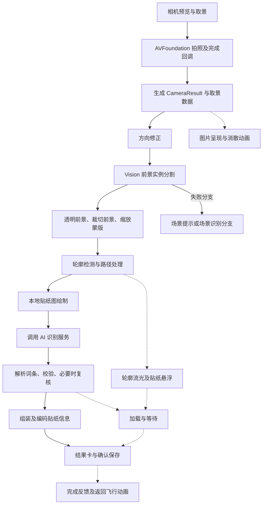

# CapWords：拍照、抠图、识别与动画实现

后续补充：[五个缺口的新增逆向结果](CAPTURE-GAPS.md)，已进一步恢复中央主体排序、裁剪公式、静态白边宽 14、43 个动作分派、逐帧 Vision／GIF 及飞回完成回调。本文原先标为未知的相关项目，以补充报告为准。

目标：用户提供的 `cap.ipa`，2.0.9（445）。日期：2026-10-16。

本次恢复了相机回调、Swift 状态与动作、部分异步调用顺序、Vision 调用、动画图层、Metal 粒子源码，以及 `default.metallib` 中的 11 个着色器模块。核心结论：**本地 Vision 产出前景与轮廓；自定义 UI／Core Animation／Metal 负责过渡与特效；应用后端负责图片语义及多语言词条。动画进度与 AI 请求完成是两条需要协调的状态链。**

样本有重打包／注入痕迹；本次未运行 iPhone App、未抓包。下文“确认”指该样本中的静态代码或资源证据，不代表每个入口都已实测。未恢复的时序、上传图像及参数不作确定结论。

## 1. 分析方法和证据

继续使用 REA 技能和本地 rea-agents 6.5.0 CLI，复用已完成的 IPA inventory、Apple application graph；新增 `inspect-analysis-view` 精确投影两项动画资源。

- 新 REA Evidence：`ev_ee5dde50dab2408a3a61fce5f3df0905536723225541cf9f72dd3c58f8101384`。
- 父 inventory：`ev_3c72b145d1531797eaf063971824a6cf8a350af28ba237bcf11b1aa4e5412617`。
- 根 IPA SHA-256：`c6cc5aba8194c044fea2f7df1c92c290fb58502a90fdb5afd3df9522c9f61fe8`。
- [REA 动画资源投影](evidence/ipa/capture-flow/rea-animation-view.json)；[提取文件哈希](evidence/ipa/capture-flow/shader-manifest.json)。

REA 不接受 `.metal` 文本作为原生 artifact，尝试结果保存在 `rea-shader-artifact.json`，不是反编译成功记录。Windows 的原生反编译引擎限制仍然存在，因此本轮细节采用现有 LLVM 反汇编、Mach-O／Swift／ObjC 元数据解码，以及实际附带的 Metal 源码与 AIR bitcode 提取交叉验证。

`default.metallib` 的 11 段原始 bitcode 保留为 `shader-00.bc` 至 `shader-10.bc`。现有 Clang 成功将它们打印为 LLVM IR；Clang 会把打印结果的 target triple／data layout 改成主机默认值，因此 `.ll` **只用于检查函数运算，不是可直接交给 Apple 工具链的原始模块**。原始 `.bc` 没有被改写。没有执行这些 shader。

主要证据文件：

- [Swift 类型、字段和枚举](evidence/ipa/capture-flow/swift-types.json)：91 项相关类型，包括嵌套 State／Action。
- [ObjC 方法与入口地址](evidence/ipa/capture-flow/objc-classes.json)：39 个相关类。ivar 中的初始偏移不是 Swift resilient class 的运行时最终偏移。
- [带 selector 注释的指令](evidence/ipa/capture-flow/annotated-capture-disassembly.txt)。
- [字符串引用候选](evidence/ipa/capture-flow/capture-string-xrefs.json)、[直接调用者索引](evidence/ipa/capture-flow/capture-function-callers.json)。这是有限指令模式索引，不能代替完整数据流／间接调用图。
- [粒子原始源码](evidence/ipa/capture-flow/DustEffectShaders.metal)、[着色器模块与哈希](evidence/ipa/capture-flow/metallib-bitcode-index.json)。

## 2. 从拍摄到结果的处理链

下图实线表示可以直接定位的主要处理顺序；虚线表示存在相关状态和动作，但所有分支之间的精确调度尚未恢复。不是实测耗时图。



### 2.1 相机采集

底层 `CameraViewController` 持有 `captureSession`、`captureDeviceInput`、`photoOutput`、`movieOutput`、`previewLayer`，并通过 `CameraSessionController` 管理队列、锁、会话运行意图和 readiness。

已恢复的具体入口：

| 入口／操作 | 静态地址 | 说明 |
| --- | --- | --- |
| `capturePhoto` ObjC 入口 | `0x1004622f8` | 用户拍照触发入口之一 |
| 拍摄实现中的开始日志 | `0x10046164c` | `camera.photo_capture_started` |
| 照片设置 | `0x1004616e8`、`0x1004617c0` | 设置 maxPhotoDimensions 和 previewPhotoFormat；没有据此认定一个固定分辨率 |
| 硬件拍照封装调用 | `0x100462b24` | `capturePhotoWithOutput:settings:delegate:` |
| 照片完成代理 | `0x1004643c0` | `captureOutput:didFinishProcessingPhoto:error:` |
| 获取照片文件数据 | `0x1004641cc` | `fileDataRepresentation`，随后桥接为 Data 并异步派发 |

上层 `StickerCameraViewController` 管理相机、裁剪页、取景框、贴纸展示 store、场景 store、dustImageView、识别任务和错误提示。点击对焦、双击切换相机、双指变焦的处理入口分别是 `0x100475ed4`、`0x100475f28`、`0x1004763cc`。

### 2.2 同一张照片存在多种表示

`CameraResult` 明确包含：`type`、`screenImage`、`visionImage`、`originalImage`、`videoURL`、`croppedRect`、`memoryTraceContext`。

这说明显示图、处理图、原图和裁剪矩形是分别管理的。不能直接认定相机预览截图就是 AI 上传图，也不能把用户取景框坐标直接当作像素坐标。相册分支还包含缩放／移动后确认的裁剪页。

`StickerRecognitionPipeline.Request` 包含 `image`、`photoCreateDate`、`photoLocation`、`createDateOverride`；管线包含 `imageOrientationFix` 计时点。元数据字段存在不等于这些字段全部上传。

### 2.3 Vision 前景抠图

实际调用链已由指令核对：

1. `0x10056aafc` 加载 `VNGenerateForegroundInstanceMaskRequest` 类引用。
2. 构造 `VNImageRequestHandler`，使用 `initWithCGImage:options:`。
3. `0x10056ac2c` 执行 `performRequests:error:`。
4. 处理 `VNInstanceMaskObservation` 与实例集合。
5. `0x10056ae60` 调用 `generateMaskedImageOfInstances:fromRequestHandler:croppedToInstancesExtent:error:`，裁切参数为 false。
6. `0x10056aec8` 调用同一接口，裁切参数为 true。
7. `0x10056af2c` 调用 `generateScaledMaskForImageForInstances:fromRequestHandler:error:`。

因此它同时具备“保留输入画布的前景”“紧贴主体边界的前景”“与输入匹配的蒙版”三类输出路径。主体实例选择尚未完全恢复，不能说固定只取中央一个物体。

这里的蒙版是真实图像处理结果；后续消散、水波纹等视觉效果不参与语义判断。

### 2.4 轮廓与贴纸图

`VNDetectContoursRequest` 创建位置 `0x100568540`；本路径设置：

- `contrastAdjustment = 2.0`。
- `detectsDarkOnLight = false`。
- `maximumImageDimension = 512`。

随后使用 contour 的归一化路径／点，形成贴纸轮廓。归一化坐标还需映射到显示矩形：展示代码中存在 contentMode、图像尺寸、CGRectInset、路径 applyTransform，不是直接把 Vision 路径原样画到屏幕。

本轮进一步恢复了正常静态图片管线中的顺序：

| 环节 | 调用证据 |
| --- | --- |
| 前景分割异步入口 | `0x10054d034` 解析相对函数指针，目标 `0x10056aa08` |
| 分割成功后再进入轮廓提取 | continuation `0x10054d068`，在 `0x10054d0e0` 解析到 `0x100568b50` |
| 轮廓成功后的结果处理 | continuation `0x10054d11c` 转入 `0x10054d188`，调用 `0x1005692b4` |
| 绘制贴纸图 | `0x10054d274` 切到 MainActor；调用 `0x10056bce8`，随后 `setNeedsLayout`、`layoutIfNeeded`，再调用图像生成 helper `0x100067c1c` |
| 本地绘制结束后进入 AI 阶段 | `0x10054d34c` 记录 outlineRendering；`0x10054d438` 切换计时标签为 ai.postImageToAI；`0x10054d4a0` 跳入 `0x1001104d8` |

这是该正常静态图片分支的顺序证据，强于仅凭日志标签猜测。其他场景、视频、演示和批处理分支不保证完全相同。

### 2.5 AI 输出词条

识图服务代码中有 `/api/v1/generate/cap-words`、应用后端认证和模型路由实现。包内 Prompt 要求先确定 `semanticIdentity`，再输出 `words`、`phonetics`、`descriptions`、`category`，部分语言另有 `wordLearningAids`。

这是“图片语义 → 对应的双语学习词条”的流程，包含容器／内容物、品牌文案、冠词、性数和地区变体的处理规则。并非只把英语识别名翻译一次。

还存在本地词典／程序化审计和条件 Stage2 文本复核，以及 V1／single-pass 等配方。不能把每次请求写成固定调用两次 AI。例句也有独立生成任务，不能保证首张结果卡出现前就已完成全部例句。

尚未完整恢复上传图像的数据来源映射，因此本报告不认定上传的一定是原图、裁剪图、透明主体或带白边图。服务端实际模型、请求成本及远端处理过程同样没有运行证据。

### 2.6 结果、编码及保存

管线包含 `aiResultPostProcess`、`stickerInfoEncoding`；错误类型分为 `visionFailed`、`aiFailed`、`encodingFailed`、`outlineImageUnavailable`。相机还有 result_database_failed、result_target_missing、result_delivered 等分支。

展示动作包含 `setStickerItem`、`showResult`、`showResultIfNeed`、`showStickerLayerButtons`、`doneButtonTapped`、`insertStickerItemToList`。这支持“识别结果进入展示状态，再由确认／保存流程处理入库和返回”的结构；所有分支的数据库提交与动画完成先后仍未逐一验证，不把入库说成一定只在飞行动画结束后才执行。

## 3. 动画与业务是两个状态系统

### 3.1 快门／底栏状态

`CameraBarState` 实际枚举：

```text
small
prepareNormalFromSmall
prepareNormalFromCompletion
normal
capture
prepareLoading
loading
completion
prepareSmall
```

这些名称支持快门存在准备、拍摄、加载和完成的不同外观。`CameraBarContentViewModel` 还含 `_rotationAnimation`、`_showLoadingCircleview`、`_loadingProgress`、`_checkermarkAnimation`、`_disableActionButtons`。因此底栏有旋转／进度／完成勾的独立反馈；没有证据表明 loadingProgress 是服务器返回的真实百分比。

### 3.2 贴纸展示状态

`StickerLayerModel.State.LayerState` 的七个实际枚举：

```text
begin / floating / dropped / loading / showResult / error / done
```

状态字段和动作互相对应：

| 视觉阶段 | 明确存在的状态／动作 | 能确定什么 |
| --- | --- | --- |
| 初始图片与消散 | startDustAnimation、setDismissImage、_dismissImage | 图片层可以独立触发消散及隐藏 |
| 主体悬浮 | stickerFloat、startFloatingAnimation、_stickerFloat | 有悬浮控制状态 |
| 主体落下／移动 | stickerDrop、moveStickerToFrame、startMoving、scaleMovingAnimation | 位置与缩放分阶段控制 |
| 轮廓出现 | showPathAnimation、fetchOutlineImage、fetchOriginalOutlineImage | 使用轮廓和渲染图的独立展示路径 |
| 波纹反馈 | incrementRippleCounter、_rippleCounter、_resultRippleCounter | 通过计数变化触发，可重复播放 |
| 等待结果 | enterLoadingMode、enterReloadingMode、showResultIfNeed、skipFloatingAnimation | 有等待、重试和跳过部分演出的分支 |
| 结果揭示 | setStickerItem、showResult、showResultBgLayer、showCompletionAnimation | 数据到达与结果背景／完成反馈分开管理 |
| 确认返回 | prepareReturnFlight、_returnFlightTarget、doneAnimation、returnFlightCompleted | 有目标矩形及返回飞行的完成事件 |
| 低内存 | setLowMemoryMode、_isLowMemoryMode | 有降级状态；具体关闭哪些效果未全部恢复 |

这些动作不是一张可以直接照抄的固定时间表。动作可能来自用户操作、异步结果或动画回调；必须避免将 Action 枚举的排列顺序当成运行顺序。具体悬浮幅度、落下曲线、飞行路径控制点及每段 delay 仍未全部恢复。

### 3.3 与新用户演示区分

包内另有 `PurchaseCCameraRecognitionHero.CameraPhase`：`idle → photosPlaced → buttonPressed → dissolving → stickersPlaced`，以及 Onboarding／GroupStickerDustImageView。这是引导／购买页的演示状态，**不能把它当作真实相机每次识别的完整状态机**。

## 4. 图片粒子消散：详细实现

核心组件：`StickerDustImageView` 包装 `DustEffectLayer`；后者使用自定义 `MetalEngine`、共享显示刷新驱动、GPU compute pipeline 与 render pipeline。

### 4.1 启动、布局与去重

`StickerDustImageView` 的字段包括 image、imageContentMode、dissolveDuration、particleStride、renderScale、maximumDustLayerSide、particleCanvasPadding、completionHandler、activeDustEffectLayer、didCompleteCleanup、isDissolveStartPending。

确认的调用关系：

- SwiftUI representable 更新路径 `0x100543f08` 记录 representable_start_received，再调用等待／启动逻辑 `0x10054470c`。
- `layoutSubviews` 入口 `0x1005445bc` 经 `0x10054449c` 更新图像与 layer 的 frame，再调用启动逻辑。
- `didMoveToWindow` 入口 `0x1005445f0` 也会重试启动。
- 实际消散构建函数是 `0x100544af8`，并有 active layer／completed 检查、waiting_for_layout 和 image_frame_missing 分支。
- 相机自身在 `0x100478598`、`0x100484084` 直接调用该消散构建函数，说明不只是演示页打包了效果。

这解决了 SwiftUI 更新时视图尚未布局、尚未挂到 window、尺寸为空或重复触发等问题。清理路径 `0x100544644` 会移除相关 view／layer；不能仅靠延时结束后假定 GPU 资源自然释放。

### 4.2 图像拆成多少粒子

`DustEffectLayer` 使用粒子网格，每个网格单元对应原图上的一个纹理小矩形，不是随机撒出与图片无关的圆点。

主机代码计算宽、高各自除以 particleStride 的网格数，申请粒子 buffer；shader 的 Particle 布局由 AIR metadata 确认为 **20 字节**：

```cpp
struct Particle {
    packed_float2 offsetFromBasePosition; // 8 bytes
    packed_float2 velocity;               // 8 bytes
    float lifetime;                      // 4 bytes
};
```

其中配置字段 particleStride 是网格间距，**不要与 20 字节的结构体步长混为一谈**。实际粒子数取决于处理后的层尺寸、间距与缩放，不能写成固定几万颗。

### 4.3 初始化公式

附带源码及编译后 `shader-05.ll` 相互支持：

```text
随机种子 = 粒子 gid（Loki 伪随机生成器）
初始位移 = (0, 0)
方向 θ = random() × 2π
速度大小 v = 42 + random() × 42
速度向量 = (cosθ, sinθ) × v
初始寿命 L = 0.7 + random() × 0.8
```

速度范围约 42～84 个局部坐标单位／模拟时间单位，寿命约 0.7～1.5 个模拟时间单位。它们不是直接等于屏幕物理像素或用户看到的秒数。

### 4.4 从左到右逐渐释放

按源码及 `shader-06.ll`，定义 `x = particleX / gridWidth`，`p = clamp(phase, 0, 0.8)`：

```text
activation = 1 - clamp(x + 0.8 - 2.25 × p, 0, 0.8) / 0.8
offset += velocity × timeStep × activation
velocity += (0, 120 × timeStep) × activation
lifetime = max(0, lifetime - timeStep × activation)
```

phase 变大时，较左边的网格先开始运动，然后向右扩展；粒子具有随机初速度和正 Y 方向加速度。这里只描述 shader 局部坐标，最终屏幕上下方向还受到纹理翻转和图层变换影响。

源码中虽然定义了 noise／grad 函数，但初始化和更新入口未调用它们；编译后的 update 也没有相应噪声采样。不能说这个消散采用了 Perlin 噪声流场。

### 4.5 每个粒子画什么

`dustEffectVertex` 用 6 个顶点组成两个三角形，实例化绘制每个网格单元：

1. 根据 instance_id 算出网格位置。
2. 按网格划分原图 UV，保持每块原始图像内容。
3. 给几何位置加上粒子位移，UV 仍留在原来的图片位置。
4. 映射到屏幕裁剪坐标。
5. 设置 `alpha = clamp(lifetime, 0, 0.3) / 0.3`。
6. fragment 采用线性采样、clamp_to_edge，并翻转纹理 Y：`texture(uv.x, 1-uv.y) × alpha`。

结果就是“照片碎成很多保留原图颜色的小片，逐步散开，并在寿命尾部淡出”。每块的渐隐尾段是 0.3 个模拟寿命单位，不是已确认的 0.3 秒。

### 4.6 CPU／GPU 调度与真实时间

已定位：

- `0x100506d28` 加载 dustEffectVertex／dustEffectFragment。
- `0x1005071ac` 加载 dustEffectInitializeParticle／dustEffectUpdateParticle。
- `0x100508368` 用 CACurrentMediaTime 计算帧间隔，包含 0.001／0.2 秒区间判断及回退，而非始终采用固定帧间隔。
- `0x100508608`、`0x100508610`：`phase += animationSpeed × dt`。
- `0x100508668`：phase 达到 4.0 后进入移除 item 的分支。
- `0x100509234` 编码 compute，第一次初始化，再更新；线程组 dispatch 已确认。
- `0x100509338`～`0x100509340`：传入 update shader 的 timeStep 构造成 `2 × dt`。
- `0x100509570`～`0x1005095a4`：依次传 size、phase、timeStep，buffer index 与源码一致。
- `0x100509b5c`：实例化绘制 `drawPrimitives:vertexStart:vertexCount:instanceCount:`。

因此 **phase 推进速度、粒子物理时间步、整个容器的完成期限是相关但不同的量**。不能把初始寿命简单除以 animationSpeed 来计算真实消失时间。

### 4.7 相机分支已确认的参数

在相机消散视图构建函数 `0x100477a98`，已定位字段写入：

| 参数 | 数值／规则 | 证据 |
| --- | --- | --- |
| dissolveDuration | `1.8181818181818181` 秒配置值 | `0x100477e08`～`0x100477e18`；位模式 `0x3ffd1745d1745d17` 写入 dissolveDuration 对应字段 |
| particleStride | `1.0` | `0x100477e28`～`0x100477e2c` |
| maximumDustLayerSide | 根据设备分类分支选择 `720` 或 `900` | `0x100477d40`～`0x100477d50`，随后写入可选值 |
| renderScale | 某分支 `1.5`，另有 `min(screenScale,2)`／`min(screenScale,3)` | `0x100477c78`～`0x100477c9c`；设备分类细节未全部恢复 |
| particleCanvasPadding | `0` | `0x100477e54` |
| animatesWhenAttachedToLayerTree | 相机构建路径写入 false | `0x100477e64`；仍有显式触发调用 |
| animationSpeed | 有效 duration 时 `4 / dissolveDuration` | `0x100544ce0`～`0x100544ce8`；本配置约 2.2 |
| 原图交叉淡出时长 | `min(dissolveDuration × 0.4, 0.22)` 秒 | `0x1005453e4`～`0x1005453fc`；随后 UIView animation |

`maximumDustLayerSide` 检查在 `0x100544b78`～`0x100544bb8`，满足缩小条件时按最长边计算缩放系数，下限 0.01。这里限制的是消散渲染层，不能当成拍照分辨率或上传图分辨率。

这些是**相机某条构建路径的配置**。SwiftUI 包装器和引导页还可传入其他配置；未实测整段效果恰好持续 1.818 秒，也未认定所有设备、模式都相同。

## 5. 轮廓流光：另一套粒子系统

它与图片碎片消散不同，使用 Core Animation 的沿路径动画和 CAEmitterLayer／CAEmitterCell。

### 5.1 图层结构

`StickerCutoutOutlineView` 的字段是 `strokeLayer`、`imageLayer`、`outlineLayer`、`glowLayer`。初始化与配置代码位于 `0x10053c170`，路径配置位于 `0x10053c430`，粒子构建位于 `0x10053c5d0`。

确认的发光参数：

- strokeLayer 的 fillColor、strokeColor 初始为 clear。
- shadowColor 为 white。
- shadowOpacity 为约 `0.35`，shadowRadius 为 `4`。
- `0x10053c514` 将轮廓按 width=3、round cap、round join 扩展成路径；经 CGPathApply 处理后赋给 shadowPath。

**这里的 3 是该发光／阴影路径构造的宽度，不是已证明的最终贴纸白边宽度。** 仍不能把整套效果描述成单纯 strokeEnd 从 0 到 1。

### 5.2 沿路径移动的粒子发射器

`0x10053c734` 构造以 `emitterPosition` 为 keyPath 的 CAKeyframeAnimation，设置输入 CGPath：

- duration：8 秒。
- repeatCount：正无穷。
- calculationMode：`kCAAnimationPaced`，按路径距离均匀运动。
- fillMode：`kCAFillModeForwards`。
- 有 beginTime 偏移的计算；不能简化成所有发射器同时从同一个点出发。

代码还通过 KVC 配置 emitterBehaviors，字符串构造可恢复为 valueOverLife／color.alpha 等相关配置。这类私有行为在目标系统上的实际兼容性未实测。

两组 emitter cell 的参数：

| 项目 | 小点轨迹 | 光晕轨迹 |
| --- | --- | --- |
| 资源名 | `dot` | `glow` |
| cell 颜色 | white | white |
| lifetime | 约 2.2 | 2.0 |
| birthRate | 1700 | 30 |
| scale | 0.185 | 1.9 |
| alphaSpeed | 约 -0.4 | 约 -0.1 |
| emitterSize | 2 × 2 | 1 × 1 |

地址：小点参数 `0x10053ca5c`～`0x10053caa4`；光晕参数 `0x10053ce4c`～`0x10053ce88`。birthRate 是 CAEmitterCell 配置值，不等于每帧粒子数。

第二组沿路径动画在 `0x10053cb9c`～`0x10053cc48` 同样设置 8 秒和无限重复。部分层透明度进入动画使用 0.4 秒参数。循环可以在 AI 等待期持续；**8 秒不是单次识别耗时，也不是用户必须等待的固定演出时长**。

## 6. 水波纹：已经恢复运算

SwiftUI 侧存在 `RippleEffect` 和 `RippleModifier`，参数 origin、trigger、elapsedTime、duration、amplitude、frequency、decay、speed。`0x100542514` 通过 ShaderLibrary 动态取 `Ripple`；`0x1005427d0` 使用 `layerEffect`；`0x1005429b4` 使用 keyframeAnimator，关键帧由 MoveKeyframe 和 LinearKeyframe 构成。

`shader-00.bc` 的 Ripple 运算可等价整理为下列伪代码。这是依据 IR 恢复的语义表达，**不是声称拿到了原始 Swift／Metal 源文件**：

```cpp
delta = position - origin;
distance = length(delta);
localTime = max(0, elapsedTime - distance / speed);
wave = amplitude * sin(frequency * localTime) * exp(-decay * localTime);
samplePosition = position + normalize(delta) * wave;
color = layer.sample(samplePosition);
color.rgb += 0.3 * (wave / amplitude) * color.a;
return color; // alpha 保持采样结果
```

传播机制：离触点越远，波纹越晚到；到达后按正弦振荡，振幅指数衰减，同时略微改变亮度。主图像没有被重新分割，只是在显示层重新采样。

触发字段有两组 rippleCounter／resultRippleCounter，但还未完整恢复每个调用点传入的 amplitude、frequency、decay、speed 数值。不能把 Apple 示例或其他项目中的默认数值当作 CapWords 参数。

## 7. 结果卡、材质和其他过渡

### 7.1 结果背景

结果卡构建代码 `0x1004adc78` 直接引用 `stickerlayer.result.bg` 和 `stickerlayer.result.bg.star`。深色分支生成 RadialGradient，并使用不同透明度；同一构建函数在 `0x1004ae130` 调用 `easeInOut(duration:1.5)`，随后 `repeatForever(autoreverses:true)`。

所以至少可以确认结果背景相关内容存在 **1.5 秒、往返循环的呼吸动画**。不能只凭这个调用把它说成主体贴纸的悬浮周期。

### 7.2 移动、弹簧与返回

结果区域代码存在 SwiftUI spring 和带 completionCriteria 的 withAnimation，例如 `0x1004ad154` 的 spring 参数 response=0.6、dampingFraction=0.9、blendDuration=0；随后 `0x1004ad1f0` 使用动画完成回调。

由于完整闭包字段映射尚未全部恢复，这组数值只归属于该结果区域函数，**不把它直接命名为“保存飞回词库的唯一弹簧参数”**。返回流程本身由 prepareReturnFlight、returnFlightTarget、doneAnimation、returnFlightCompleted 明确支持。

### 7.3 快门材质并非只有静态图片

本轮恢复出的 11 个 shader 模块：

| 模块 | 已确认职责 |
| --- | --- |
| Ripple | 距离传播、正弦位移、指数衰减及亮度变化 |
| distortion | 根据 progressX／progressY 做非均匀形变；具体全流程使用点未完全映射 |
| captureAperturePaper | 按 source、paper、paperAmount、brightness、bladeSoftening 混合快门纸张材质，保留 alpha |
| capturePaperGrain | 以 floor(position×2) 构造哈希噪声，对 RGB 加细微纸纹，保留 alpha |
| softPaperArtwork | 对 RGB 进行柔化／提亮形式的颜色变换，保持 alpha |
| dustEffectInitializeParticle | 粒子随机速度与寿命 |
| dustEffectUpdateParticle | 逐列激活、运动、加速度与寿命更新 |
| dustEffectVertex | 图片网格切片与顶点输出 |
| dustEffectFragment | 纹理采样及粒子淡出 |
| clearVertex / clearFragment | 渲染清理相关基础 shader |

`capturePaperGrain` 的哈希不含 time 输入，因此它是空间纸纹，不能说它自身会每帧随机闪动。`distortion` 的部分声明参数在编译后没有参与运算；不能仅凭参数名宣称存在相应视觉效果。

### 7.4 声音、触觉与帧率

包内有 SoundEffectManager、数个 wav／mp3 以及触觉状态。尚未逐一映射“哪个文件就是快门声／落下声”，也没有实测每段是否播放。共享 display-link driver 含 framesPerSecond 配置与前后台控制线索，但本次没有证明该效果固定 60 FPS 或 120 FPS。

## 8. 异常与不同媒体分支

| 情况 | 代码／状态证据 | 应如何解释 |
| --- | --- | --- |
| 还未完成布局 | waiting_for_layout、isDissolveStartPending、layoutSubviews／didMoveToWindow | 等待可用 frame 后再尝试启动效果 |
| 无 CGImage／粒子 buffer 分配失败 | missing_cg_image、particle_buffer_allocation_failed | 动画构建失败，不等于 AI 已经失败 |
| 抠图或轮廓失败 | visionFailed、outlineImageUnavailable、stickerToSceneFallback | 有整图场景分支及提示；不能保证每次自动回退成功 |
| 网络或 AI 失败 | aiFailed、networkError、重试动作 | 进入错误界面或重新加载，不应一直播放假进度 |
| 词条编码／入库失败 | encodingFailed、camera.result_database_failed | 识图成功不等于已经保存成功 |
| Live Photo | isWaitingForLivePhoto、静态照和 movieURL、requestID | 等待照片与视频资源，转换和结果交付另有丢弃／过期处理 |
| 短视频 | onVideoRecorded、isCroppedVideo、gifURL、showGifView、maskAnimation | 动态媒体展示有独立状态，不能按静态图消散参数全面外推 |
| 重试／场景／演示 | apiTask、sceneApiTask、usesDemoMedia、skipFloatingAnimation | 不保证每次重播完整相同演出 |

## 9. 已恢复与仍缺少的细节

已经恢复到可用于设计复现方案的层次：相机代理与图片表示、正常静态管线的主要串行顺序、Vision 系统接口、轮廓检测参数、展示状态与动作、消散算法和相机配置、沿轮廓流光参数、水波纹运算、结果背景呼吸动画、材质 shader 的计算职责。

仍缺少：完整 Swift reducer 的逐分支状态转换表、主体悬浮／落下／返回飞行的全部曲线与时间、最终静态白边完整绘制参数、上传图片的确切来源、当前线上模型与路由、真实帧率和实测耗时。要得到逐帧完全一致的动画时间线，必须有相同原版构建的运行录像／设备观察；现有静态证据不能替代这些结果。

复核用脚本：[元数据解码](analyze_capture_flow.py)、[指令与 selector 索引](index_capture_code.py)、[Metal bitcode 提取与 IR 打印](decode_capture_shaders.py)。此前的识图 Prompt 和抠图指令细节见 [IPA-REPORT.md](IPA-REPORT.md)。
